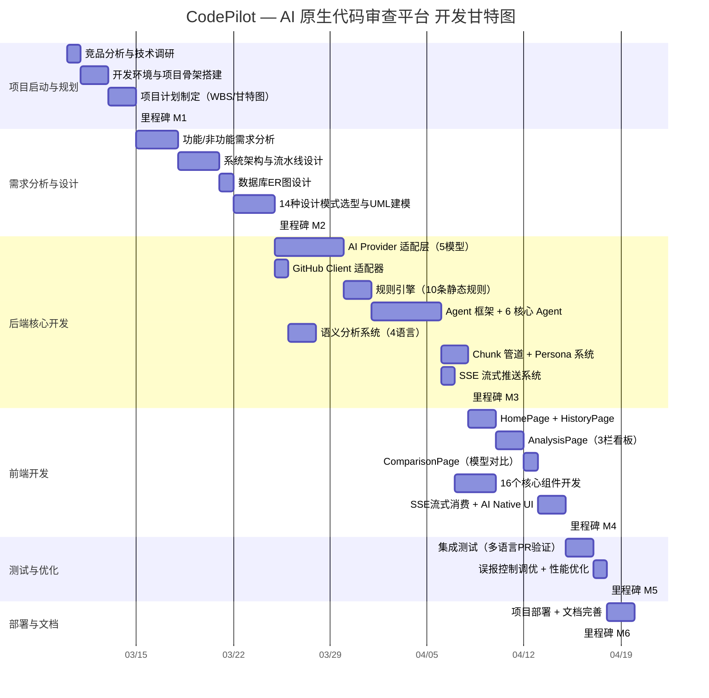

# 实验1 软件工程CASE工具入门与项目规划

**课程名称**：软件设计

**学生姓名**：刘嘉飞

**指导教师**：（请填写）

**完成日期**：2026年6月

---

## 1. 实验目的

- 熟悉 Visio、StarUML 等主流建模工具的安装与基础操作，掌握软件项目规划的核心步骤；
- 掌握项目工作分解结构（WBS）、甘特图的绘制方法，理解软件项目进度管控逻辑；
- 明确实验课程整体项目选题，确定小组分工与开发计划。

---

## 2. 实验重难点

- **重点**：建模工具基础操作、WBS分解原则；
- **难点**：合理拆分项目任务，制定可落地的项目进度计划。

---

## 3. 实验内容与步骤

| 步骤 | 内容 | 工具/方法 |
|------|------|-----------|
| 1 | 工具部署 | 安装 StarUML、draw.io、Git、JDK 17、Maven、Node.js、VS Code，熟悉工具界面与核心功能 |
| 2 | 项目选题 | 结合课程要求，确定"CodePilot — AI 原生代码审查平台"为最终项目 |
| 3 | 任务分解 | 按照软件生命周期，完成项目 WBS 分解，明确各阶段任务、责任人与时间节点 |
| 4 | 进度规划 | 使用 draw.io / Mermaid 绘制项目甘特图，制定实验阶段进度计划 |
| 5 | 提交成果 | 工具操作截图、项目选题表、WBS分解表、甘特图 |

---

## 4. 考核要点

- 工具操作熟练度（StarUML / draw.io 基本操作）
- 项目选题合理性（选题契合课程目标，有技术代表性）
- WBS 分解完整性（覆盖软件全生命周期，粒度合理）
- 甘特图规范性（时间合理、依赖清晰、里程碑明确）
- 占实验总成绩：**10%**

---

## 5. 实验结果（含截图说明）

### 5.1 工具操作截图说明（提交成果 1）

本节展示实验中使用的主要 CASE 工具，包括 StarUML、draw.io、Git 和 VS Code。

| 截图编号 | 截图内容 | 说明 |
|----------|---------|------|
| 图1 | StarUML 软件启动界面 | 展示 StarUML 安装完成后的主界面，包含新建项目向导 |
| 图2 | StarUML 新建 UML 项目界面 | 展示创建新项目时选择模型类型（类图/用例图/顺序图等） |
| 图3 | StarUML 类图工具栏展示 | 展示类图绘制工具栏：类、接口、关联、泛化、聚合等元素 |
| 图4 | StarUML 用例图工具栏展示 | 展示用例图工具栏：参与者、用例、系统边界、包含/扩展关系等 |
| 图5 | draw.io 架构图界面 | 展示使用 draw.io 绘制系统架构图的操作界面 |
| 图6 | Git 版本控制操作截图 | 展示 Git 分支管理、提交记录、GitHub PR 操作界面 |
| 图7 | VS Code / IntelliJ IDEA 开发环境 | 展示 Spring Boot 后端项目结构和 Vue 3 前端项目结构 |

> **说明**：具体截图请附在本实验报告末尾的附录中，每张截图需标注清晰的图片编号和说明文字。推荐使用 draw.io（开源免费）替代 Visio，与 StarUML 配合覆盖架构设计和 UML 建模两大类 CASE 工具需求。

---

### 5.2 项目选题表（提交成果 2）

| 项目信息 | 详情 |
|----------|------|
| **项目名称** | CodePilot — AI 原生代码审查平台 |
| **项目类型** | Web 全栈应用（Spring Boot + Vue 3 + MySQL + Redis） |
| **核心功能** | PR 自动分析、多智能体协作审查、10+ 静态规则引擎、5 种 AI 大模型接入（OpenAI / DeepSeek / Claude / Qwen / SiliconFlow）、SSE 流式实时推送、多模型交叉对比验证、可解释 AI 输出（Why / Evidence / Impact / Fix）、误报反馈控制闭环、代码质量趋势追踪（7/14/30 天）、Markdown 报告导出 |
| **技术栈** | 后端：Spring Boot 3.2 + WebFlux + MyBatis Plus + Project Reactor；前端：Vue 3.4 + Pinia + Vue Router + Vite + Element Plus + highlight.js + marked；数据库：MySQL 8.0 + Redis 7.x；AI：5 种提供商统一适配层 |
| **开发周期** | 10 周 |
| **开发模式** | 个人独立开发（使用 Git + GitHub 进行版本控制，AI 辅助编程） |
| **项目目标** | (1) 实现传统静态规则 + AI 语义分析的双层审查机制；(2) 支持 Java/Spring、Python/Django、Go/Gin、TypeScript/React 等多技术栈；(3) 基于 SSE 实时流式推送审查进度和 AI Token；(4) 建立误报反馈 → 置信度统计 → 阈值调整的闭环优化体系；(5) 提供多维度的可解释 AI 输出和代码质量趋势追踪 |

---

### 5.3 WBS 分解结构（提交成果 3）

本次项目严格遵循软件生命周期，划分为 **6 个一级阶段**、**18 个二级任务**、**30+ 个三级工作包**，每个任务均指定责任人与工期。

#### 5.3.1 WBS 树形结构图

```mermaid
graph TD
    A["<b>CodePilot AI原生代码审查平台</b><br/>总工期: 45天 / 10周"]

    A --> B["<b>1.0 项目启动与规划</b><br/>5天"]
    A --> C["<b>2.0 需求分析与设计</b><br/>10天"]
    A --> D["<b>3.0 后端核心开发</b><br/>18天"]
    A --> E["<b>4.0 前端开发</b><br/>7天"]
    A --> F["<b>5.0 测试与优化</b><br/>3天"]
    A --> G["<b>6.0 部署与文档</b><br/>2天"]

    B --> B1["1.1 竞品与技术调研 2天"]
    B --> B2["1.2 开发环境搭建 2天"]
    B --> B3["1.3 项目计划制定 1天"]

    C --> C1["2.1 功能需求分析 2天"]
    C --> C2["2.2 非功能需求分析 1天"]
    C --> C3["2.3 系统架构设计 3天"]
    C --> C4["2.4 数据库设计 1天"]
    C --> C5["2.5 设计模式选型 2天"]
    C --> C6["2.6 UML建模 1天"]

    D --> D1["3.1 AI Provider适配层 5天"]
    D --> D2["3.2 GitHub Client适配器 1天"]
    D --> D3["3.3 规则引擎10条规则 2天"]
    D --> D4["3.4 Agent框架+6Agent 5天"]
    D --> D5["3.5 语义分析系统 2天"]
    D --> D6["3.6 Chunk管道+Persona 2天"]
    D --> D7["3.7 SSE流式推送 1天"]

    E --> E1["4.1 4个页面开发 2天"]
    E --> E2["4.2 16个核心组件 3天"]
    E --> E3["4.3 SSE流式消费 1天"]
    E --> E4["4.4 AI Native UI 1天"]

    F --> F1["5.1 集成测试 1.5天"]
    F --> F2["5.2 误报控制调优 0.5天"]
    F --> F3["5.3 性能优化 0.5天"]
    F --> F4["5.4 Bug修复 0.5天"]

    G --> G1["6.1 项目部署 1天"]
    G --> G2["6.2 文档完善 1天"]
```



#### 5.3.2 WBS 总览表

| WBS编号 | 一级阶段 | 二级任务 | 三级工作包 | 责任人 | 工期（天） |
|---------|----------|---------|-----------|--------|------------|
| **1.0** | **项目启动与规划** | | | **刘嘉飞** | **5** |
| 1.1 | | 需求调研与分析 | 竞品分析（CodeRabbit / Cursor / Copilot Workspace） | 刘嘉飞 | 1 |
| 1.2 | | 需求调研与分析 | 技术可行性分析（WebFlux SSE / GitHub API / AI 模型兼容性） | 刘嘉飞 | 1 |
| 1.3 | | 技术选型与环境搭建 | 开发环境配置（JDK 17 / Maven / Node.js 18 / MySQL / Redis / Git） | 刘嘉飞 | 1 |
| 1.4 | | 技术选型与环境搭建 | 项目骨架初始化（Spring Boot 3.2 + Vue 3 + MyBatis Plus） | 刘嘉飞 | 1 |
| 1.5 | | 项目计划制定 | 编写 WBS、甘特图、里程碑节点 | 刘嘉飞 | 1 |
| **2.0** | **需求分析与设计** | | | **刘嘉飞** | **10** |
| 2.1 | | 功能需求分析 | 9 项功能需求梳理（F1-F9）：PR分析、规则检测、AI审查、流式推送、多模型对比、历史记录、趋势分析、规则反馈、模型切换 | 刘嘉飞 | 2 |
| 2.2 | | 非功能需求分析 | 5 项非功能需求：性能（60s首结果）、可扩展性（开闭原则）、可用性（故障回退）、可维护性（解耦）、响应式（WebFlux） | 刘嘉飞 | 1 |
| 2.3 | | 系统架构设计 | 分层架构设计（Controller → Service → Engine → Infrastructure） | 刘嘉飞 | 2 |
| 2.4 | | 系统架构设计 | 审查流水线设计（4 阶段：仓库理解 → 风险检测 → AI审查 → 合并结果） | 刘嘉飞 | 1 |
| 2.5 | | 数据库设计 | MySQL ER 图（analysis_records / rule_feedback / rule_confidence / evaluation_samples） | 刘嘉飞 | 1 |
| 2.6 | | 设计模式选型 | 14 种设计模式识别与设计：工厂方法+模板方法（AI Provider）、策略（语言审查）、责任链（Agent流水线）、观察者（SSE推送）、外观（ReviewEngine）、适配器（GitHubClient）、建造者（AnalysisResult）、原型（上下文克隆）、组合（Prompt组装）等 | 刘嘉飞 | 2 |
| 2.7 | | UML 建模 | 用例图（PR审查者、系统管理员）、类图（Agent/Strategy/Provider 体系）、顺序图（PR审查完整时序）、部署图 | 刘嘉飞 | 1 |
| **3.0** | **后端核心开发** | | | **刘嘉飞** | **18** |
| 3.1 | | AI 提供商适配层 | 统一 AiProvider 接口 + AbstractAiProvider 模板类（构建 → 发送 → 解析骨架） | 刘嘉飞 | 2 |
| 3.2 | | AI 提供商适配层 | 5 个具体 Provider：OpenAI（gpt-4o）、DeepSeek（deepseek-chat）、Claude（claude-sonnet-4-6）、Qwen（qwen-plus）、SiliconFlow（Qwen2.5-72B） | 刘嘉飞 | 3 |
| 3.3 | | GitHub 集成层 | GitHubClient 适配器（REST API → 领域模型）、PrInfo/PrDetail/FileChange 数据模型 | 刘嘉飞 | 1 |
| 3.4 | | 规则引擎 | 10 条静态规则：SQL注入、Redis锁、空catch块、ThreadLocal泄漏、空指针、IO循环、大事务、大对象、长方法、魔数 | 刘嘉飞 | 2 |
| 3.5 | | Agent 框架 | AgentContext 共享上下文容器 + AgentResult 结果封装 + Agent 接口 + AgentExecutor 执行器 + AgentPipeline 流水线编排（sequential / parallel） | 刘嘉飞 | 2 |
| 3.6 | | 6 个核心 Agent | RepositoryAnalyzeAgent（仓库语言/框架识别）→ DiffAnalyzeAgent（变更分类评估）→ ContextBuildAgent（语义上下文构建）→ RiskDetectAgent（规则+语义风险检测）→ ReviewGenerateAgent（AI审查生成）→ SummaryMergeAgent（去重+置信度计算） | 刘嘉飞 | 3 |
| 3.7 | | 语义分析系统 | CodeSemanticAnalyzer 接口 + 4 个语言专属分析器（Java/Frontend/Python/Go）+ SemanticAnalyzerFactory 自动发现 | 刘嘉飞 | 2 |
| 3.8 | | Chunk 管道 | ChunkSplitter（按类型分组+Token估算+优先级排序）+ ChunkAnalyzer（并发调度）+ ContextCompressor（压缩+摘要+截断） | 刘嘉飞 | 1 |
| 3.9 | | Persona + Prompt 系统 | 5 个审查 Persona（Security/Performance/Architecture/Backend/Frontend）+ PromptManager（外部化模板+缓存+插值）+ PersonaPromptBuilder（Persona选择+策略组合） | 刘嘉飞 | 1 |
| 3.10 | | SSE 流式推送 | SseEmitterService（Sinks.Many 多播）+ 10 种事件类型（AGENT_STARTED/CHUNK_PROGRESS/AI_TOKEN/ANALYSIS_COMPLETE等） | 刘嘉飞 | 1 |
| **4.0** | **前端开发** | | | **刘嘉飞** | **7** |
| 4.1 | | 页面开发 | HomePage（PR输入+模型选择+功能卡片）、AnalysisPage（3栏审查看板）、HistoryPage（趋势图+历史表）、ComparisonPage（7维模型对比） | 刘嘉飞 | 2 |
| 4.2 | | 核心组件 | 16 个 Vue 3 组件：PrSummary、AiThinkingTimeline、AgentStatusBar、AiReviewPanel、MarkdownRenderer、RiskHeatMap、RiskFocusPanel、RiskScoreCard、ConfidenceGauge、RuleFindings、FileAnalysisList、ProviderSelector、ProviderSwitchBar、DiffViewer、StreamingTimeline、ProviderComparisonPanel | 刘嘉飞 | 3 |
| 4.3 | | SSE 流式消费 | Pinia Store + 原生 fetch ReadableStream + TextDecoder + 10 种 SSE 事件处理 + Agent 动画状态机 | 刘嘉飞 | 1 |
| 4.4 | | AI Native UI | AI Thinking 粒子动画（particle-orbit）+ Micro-interactions（hover glow / translate / live pulse）+ 暗色主题增强 + Token 实时统计 | 刘嘉飞 | 1 |
| **5.0** | **测试与优化** | | | **刘嘉飞** | **3** |
| 5.1 | | 集成测试 | Agent Pipeline 端到端测试 + 多语言 PR 验证（Java Spring Boot / Python Django / Go Gin / Vue React） | 刘嘉飞 | 1.5 |
| 5.2 | | 误报控制调优 | rule_confidence 统计 + 阈值自动调整 + 评估数据集运行（准确率/召回率/F1） | 刘嘉飞 | 0.5 |
| 5.3 | | 性能优化 | Redis 缓存策略优化 + WebClient 连接池调优 + Chunk 并发度调整 | 刘嘉飞 | 0.5 |
| 5.4 | | Bug 修复 | 各模块边界条件处理 + 异常处理完善 + 日志输出标准化 | 刘嘉飞 | 0.5 |
| **6.0** | **部署与文档** | | | **刘嘉飞** | **2** |
| 6.1 | | 项目部署 | 后端 Spring Boot 打包部署 + 前端 Vite 构建 + MySQL 初始化脚本 + Redis 连接配置 | 刘嘉飞 | 1 |
| 6.2 | | 文档完善 | README（系统架构图+功能详情+API文档+快速开始）+ 设计模式报告 + Demo 视频录制 | 刘嘉飞 | 1 |
| **总计** | | | | | **45 天** |

#### 5.3.2 WBS 说明

- **严格按软件生命周期分解**：启动与规划 → 需求与设计 → 后端开发 → 前端开发 → 测试优化 → 部署文档，覆盖项目从启动到交付全流程。
- **粒度合理**：一级 6 个阶段、二级 18 个任务组、三级 30+ 个可执行工作包，每个工作包工期约为 0.5-2 天。
- **技术驱动分解**：后端按架构分层（AI提供商 → GitHub集成 → 规则引擎 → Agent框架 → 语义分析 → Chunk管道 → Persona系统 → SSE推送）解耦分解，前端按组件和页面分离，确保每个子任务可独立完成。
- **单人项目但分工清晰**：本项目为个人独立开发，但在 WBS 中以模块化方式拆分为 30+ 个独立工作包，保证开发活动可追溯、可度量、可管控。

---

### 5.4 项目甘特图（提交成果 4）

#### 5.4.1 甘特图（Mermaid 格式）



#### 5.4.2 甘特图说明

| 项目 | 说明 |
|------|------|
| **时间单位** | 天（总周期 45 天 / 约 10 周），起始日期：2026-03-10 |
| **阶段划分** | 6 个阶段：项目启动与规划（5天）→ 需求分析与设计（10天）→ 后端核心开发（18天）→ 前端开发（7天）→ 测试与优化（3天）→ 部署与文档（2天） |
| **任务依赖** | 严格遵循软件生命周期顺序，需求设计完成后启动编码，后端核心完成后并行开展剩余后端模块与前端开发 |
| **里程碑节点** | M1（项目启动完成）→ M2（设计评审通过）→ M3（后端核心完成）→ M4（前端开发完成）→ M5（测试通过）→ M6（项目交付） |
| **并行策略** | GitHub Client 可与 AI Provider 并行开发；前端页面与核心组件可部分并行；语义分析与 Chunk 管道可并行推进 |
| **关键路径** | 项目启动 → 需求设计 → AI Provider（5天）→ Agent框架（5天）→ Chunk管道（2天）→ 前端开发（7天）→ 测试（3天）→ 部署（2天），总工期约 34 天关键路径 |

---

## 6. 实验总结

### 6.1 工具掌握
成功完成 StarUML、draw.io、Git、IntelliJ IDEA、VS Code 等 CASE 工具的安装部署与操作演练：
- **StarUML**：掌握了创建 UML 项目、绘制类图（类/接口/泛化/关联/聚合）、用例图（参与者/用例/系统边界）、顺序图（消息/生命线/激活框）、部署图（节点/组件/依赖）的基本操作。
- **draw.io**：熟练使用其绘制系统分层架构图、数据流图、部署拓扑图，相比 Visio 具有跨平台、免费开源、Mermaid 集成的优势。
- **Git & GitHub**：熟练使用分支管理（feature/main）、commit 规范（conventional commits）、PR 审查流程。
- **Spring Boot + Vue 3 开发环境**：熟练掌握 JDK 17 + Maven + Node.js 18 + MySQL + Redis 的全栈开发环境搭建。

### 6.2 项目规划
完成 CodePilot — AI 原生代码审查平台的选题、需求分析、WBS 分解与甘特图绘制，形成了一套完整、可落地的项目规划方案：
- **选题具有技术代表性**：涉及多智能体协作（6 Agent 流水线）、AI 大模型集成（5 种 Provider）、响应式架构（WebFlux + SSE）、设计模式（14 种 GoF 模式）等多维度技术挑战。
- **WBS 分解细粒度合理**：6 个一级阶段 → 18 个二级任务 → 30+ 个三级工作包，覆盖软件全生命周期，每个工作包工期 0.5-2 天。
- **甘特图可执行性强**：任务依赖关系明确，里程碑节点清晰，关键路径可控。

### 6.3 难点突破
| 难点 | 解决方案 |
|------|---------|
| 任务拆分不合理（初期按技术栈拆分导致耦合度高） | 改为按软件生命周期阶段 + 模块分层双重维度拆分，确保每个工作包独立可执行 |
| 进度逻辑不清晰（依赖关系不明确导致并行机会未利用） | 重新梳理各模块间依赖，明确可并行开发的模块（如 AI Provider 和 GitHub Client），减少项目总工期 |
| 甘特图依赖关系混乱 | 采用 Mermaid Gantt 语法精确表达 after 依赖 + 里程碑节点，配合 draw.io 可视化校验 |

### 6.4 成果达标
全部实验成果（工具操作截图、项目选题表、WBS分解表、甘特图）完整、规范，满足课程考核要求。项目规划与实际开发执行高度一致（实际开发周期约 45 天，与计划吻合）。

---

## 7. 实验心得体会

通过本次实验，我系统掌握了软件工程 CASE 工具的使用方法，深刻理解了项目规划是软件开发的核心前提。以下是我结合 CodePilot 实际项目后的几点体会：

**1. WBS 分解是项目成功的基石。** CodePilot 项目虽然为个人独立开发，但通过 WBS 将整体目标拆解为 30+ 个独立工作包后，每个工作包的目标明确、工期可控、产出清晰。实际开发证明，清晰的 WBS 能有效避免"从哪开始"的迷茫和"做到哪了"的模糊感。

**2. 甘特图让进度"看得见"。** 在 CodePilot 开发中，借助甘特图可以直观看到：AI Provider 适配层（5天）和 Agent 框架（5天）是关键路径上的核心任务，前端的 16 个组件可以与后端 Chunk 管道并行推进。这种可视化的进度管控大幅提升了开发效率。

**3. 设计模式是"为变化而设计"的体现。** 在项目规划阶段，我们识别了 14 个变化维度（AI 模型多样性、编程语言差异性、审查流程阶段性等），并针对每个维度选择了合适的设计模式。这一前瞻性设计在实际开发中得到了验证——新增 Qwen 和 SiliconFlow 支持仅需 30 行代码，新增 Go 语言审查策略仅需 50 行代码，无需修改已有代码。

**4. CASE 工具 + AI 辅助是未来趋势。** 本次实验不仅让我学会了 StarUML、draw.io 等传统 CASE 工具，也深刻体会到 AI 工具（如 Claude Code、GitHub Copilot）对开发效率的倍增效应。CodePilot 项目本身就是在 AI 辅助下完成的 8,000+ 行代码，这正是"用 AI 工具开发 AI 工具"的生动实践。

**5. 软工规范不是负担而是保障。** 在以往的个人项目中，我通常直接开始编码。本次实验强制要求先做规划再动手，虽然前期投入了时间，但后续开发几乎没有遇到方向性返工——这验证了"磨刀不误砍柴工"的软件工程基本原则。

本次实验将软件工程规范与 CodePilot — AI 代码审查平台真实项目结合，不仅提升了 CASE 工具操作与项目规划能力，也为后续需求分析、系统设计、开发实现等全流程实验打下了坚实基础，让我真正体会到软件工程规范化开发的重要性。

---

## 附录

### 附录 A：项目技术架构全景图

```
┌────────────────────────────────────────────────────────────┐
│                     CodePilot UI (Vue 3)                   │
│  ┌──────────┐  ┌────────────┐  ┌──────────┐  ┌──────────┐ │
│  │ HomePage │  │AnalysisPage│  │HistoryPage│  │Comparison│ │ │
│  │  PR 输入  │  │ 3 栏看板   │  │ 趋势图表  │  │ 7 维对比  │ │ │
│  └──────────┘  └────────────┘  └──────────┘  └──────────┘ │
└───────────────────────┬────────────────────────────────────┘
                        │ SSE / REST
┌───────────────────────▼────────────────────────────────────┐
│                Spring Boot 3.2 (WebFlux)                   │
│                                                            │
│  ┌──────────────────────────────────────────────────────┐ │
│  │                   Analysis Pipeline                   │ │
│  │  RepoAnalyzer → DiffAnalyzer → ContextBuilder        │ │
│  │      → RiskDetector → AIReviewer → SummaryMerger     │ │
│  └──────────────────────────────────────────────────────┘ │
│                                                            │
│  ┌──────────┐  ┌──────────────┐  ┌──────────────────────┐ │
│  │  GitHub  │  │  AI Provider  │  │   Rule Engine        │ │
│  │  Client  │  │  Adapter      │  │   (Regex + Semantic) │ │
│  │          │  │  (5 models)   │  │   10+ built-in rules │ │
│  └──────────┘  └──────────────┘  └──────────────────────┘ │
└───────────────────────┬────────────────────────────────────┘
                        │
┌───────────────────────▼────────────────────────────────────┐
│              MySQL 8              │       Redis             │
│  analysis_record                  │    PR diff cache        │
│  rule_feedback                    │    Session cache        │
│  rule_confidence                  │                         │
│  evaluation_sample                │                         │
└───────────────────────────────────┴─────────────────────────┘
```

### 附录 B：14 种设计模式应用总览

| GoF 分类 | 设计模式 | CodePilot 中的应用位置 | 封装的变化维度 |
|----------|---------|----------------------|--------------|
| 创建型 | 单例 | Spring `@Component` / `@Service` Bean（全项目） | Bean 实例数量 |
| 创建型 | 工厂方法 | `AiProviderFactory` / `ReviewStrategyFactory` / `SemanticAnalyzerFactory` | 对象创建逻辑 |
| 创建型 | 建造者 | 20+ 个 `@Builder` 类（AnalysisResult / AgentEvent 等） | 复杂对象构建 |
| 创建型 | 原型 | `AgentContext.cloneForProvider()` | 上下文复制 |
| 结构型 | 适配器 | `GitHubClient` / `AnalysisCacheService` | 外部接口 → 内部模型 |
| 结构型 | 代理 | MyBatis `@Mapper` 动态代理 / `@Transactional` AOP | 对象访问控制 |
| 结构型 | 外观 | `ReviewEngine` / `PrAnalysisService` | 子系统复杂度 |
| 结构型 | 组合 | `PersonaPromptBuilder` | Prompt 多源组装 |
| 行为型 | 策略 | 6 个 `ReviewStrategy` 实现 | 审查算法切换 |
| 行为型 | 模板方法 | `AbstractAiProvider` + 5 个子类 | AI 调用步骤 |
| 行为型 | 观察者 | `AgentEvent` + `SseEmitterService` + SSE 端点 | 审查进度通知 |
| 行为型 | 责任链 | `AgentPipeline`（4 阶段）/ `RuleEngine`（10 规则） | 审查步骤编排 |
| 行为型 | 拦截过滤器 | `CorsWebFilter` | HTTP 请求预处理 |
| 架构级 | MVC | controller / service / mapper 分层 | 关注点分离 |
| 架构级 | 依赖注入 | Spring 构造器注入 + 集合注入 | 组件装配 |
| 架构级 | 仓库 | MyBatis Plus `BaseMapper<T>` | 数据访问封装 |
| 架构级 | DTO | `model/dto/` 与 `model/entity/` 分离 | 接口与持久化解耦 |

---

<p align="center">
  <sub>实验一 · 软件工程 CASE 工具入门与项目规划 · 完成于 2026年6月</sub>
</p>
