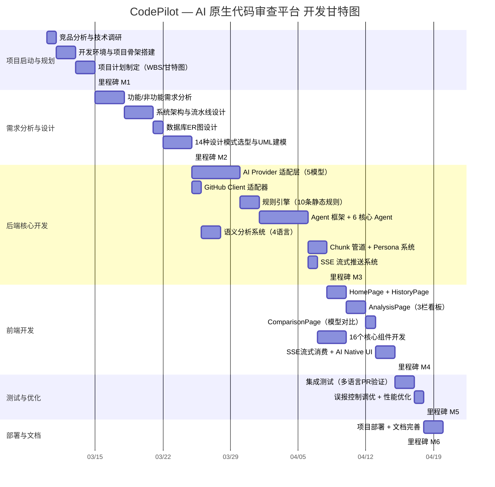

# AI 驱动的生存期模型 CodePilot 系统设计与实现

**课程名称**：软件项目管理

**题目**：AI 驱动的生存期模型 XXXX 系统设计与实现（XXXX = CodePilot）

**学生姓名**：刘嘉飞

**学号**：（请填写）

**专业班级**：（请填写）

**指导教师**：（请填写）

**完成日期**：2026年10月

---

## 摘要

本报告以「AI 驱动的生存期模型 CodePilot 系统设计与实现」为题，完整呈现一个 AI 原生代码审查平台从立项到交付的软件项目管理全过程。项目以**瀑布模型（含局部并行）**作为生存期模型，覆盖项目启动、需求分析、系统设计、编码实现、测试优化、部署交付六个阶段，累计 45 人天（约 2.5 人月）。报告依据 PMBOK 知识体系，逐项论述范围、时间、成本、风险、质量、沟通、人力、配置等管理活动，并结合 CodePilot 系统的实际设计与实现（多智能体审查流水线、规则引擎、SSE 流式推送、误报控制闭环等）进行交叉印证，验证了软件项目管理方法在真实 AI 系统开发中的可落地性。

**关键词**：软件项目管理；生存期模型；瀑布模型；工作分解结构（WBS）；风险管理；AI 代码审查；多智能体

---

## 一、项目概述

### 1.1 选题背景

随着软件开发规模的不断扩大，Pull Request（PR）的数量与代码变更复杂度持续增长。传统人工 Code Review 存在四大痛点：

| 痛点 | 具体表现 |
|------|---------|
| **效率瓶颈** | 大 PR 动辄上千行 diff，人工逐行审查耗时数小时 |
| **标准不一致** | 不同评审人的关注点与尺度差异大，结论难以统一 |
| **知识局限** | 评审人难以同时精通安全、性能、并发、前端等全部领域 |
| **疲劳漏检** | 长时间审查导致注意力下降，低层级的空指针、资源泄漏等缺陷容易被遗漏 |

AI 大语言模型（LLM）的语义理解能力为上述痛点提供了新的解决路径。本课题据此设计并实现 **CodePilot**——一个融合「传统静态规则引擎」与「大模型语义分析」的 AI 原生代码审查平台。

### 1.2 项目是什么

**CodePilot** 是一款基于多智能体协作流水线的 GitHub PR 自动化审查系统：输入一个 PR 链接，系统自动拉取变更 diff，经 6 个专业化 Agent 顺序协作完成分析，输出风险评分、可解释审查意见与改进建议，并支持 SSE 流式实时反馈、多模型交叉验证与误报控制闭环。

### 1.3 AI 驱动的体现

| 维度 | AI 能力 |
|------|---------|
| 多智能体流水线 | 6 个 Agent 自动协作：仓库分析 → Diff 解析 → 上下文构建 → 风险检测 → AI 评审 → 汇总合并 |
| 多模型接入 | 统一适配 OpenAI、DeepSeek、Claude、Qwen、SiliconFlow 五种大模型，支持单模型或双模型对比 |
| 语义级缺陷检测 | 在静态规则之上，通过 LLM 识别逻辑缺陷、架构问题、性能隐患 |
| 可解释 AI 输出 | 每条发现附带 Why / Evidence / Impact / Fix 四维解释与置信度评分 |
| 自适应优化 | 用户反馈 → 置信度统计 → 阈值自动调整的误报控制闭环 |

### 1.4 项目基本信息表

| 项目信息 | 详情 |
|----------|------|
| 项目名称 | CodePilot — AI 原生代码审查平台 |
| 项目类型 | Web 全栈应用（Spring Boot + Vue 3 + MySQL + Redis） |
| 核心功能 | PR 自动分析、多智能体协作审查、10+ 静态规则、5 种 AI 模型、SSE 流式推送、多模型对比、可解释 AI、误报控制闭环、质量趋势追踪、Markdown 报告导出 |
| 技术栈 | 后端 Spring Boot 3.2 + WebFlux + MyBatis Plus + Project Reactor；前端 Vue 3.4 + Pinia + Vite；数据库 MySQL 8.0 + Redis 7.x |
| 开发周期 | 45 天 / 约 10 周 |
| 开发模式 | 个人独立开发（Git + GitHub 版本控制，AI 辅助编程） |
| 代码规模 | 8000+ 行 |

---

## 二、生存期模型选型

### 2.1 生存期模型概述

软件生存期模型（Software Life Cycle Model）描述了软件从提出、定义、开发、使用到退役的整个过程中各项活动的组织方式。主流模型包括瀑布模型、增量模型、迭代模型、螺旋模型与敏捷模型等，其差异主要体现在**阶段划分方式、反馈迭代机制、风险应对策略**三个方面。

### 2.2 候选模型对比

| 模型 | 核心特征 | 适用场景 | 本项目适配度 |
|------|---------|---------|------------|
| 瀑布模型 | 阶段严格顺序推进，文档驱动，阶段末评审 | 需求明确、技术成熟、变更少 | ★★★★★ |
| 增量模型 | 分模块分批交付，逐步叠加功能 | 核心功能先行，可分期发布 | ★★★☆☆ |
| 迭代/螺旋 | 多轮迭代，风险驱动，逐步精化 | 需求不确定、风险高 | ★★★☆☆ |
| 敏捷/Scrum | 短冲刺、快速反馈、拥抱变化 | 团队协作、需求频繁变更 | ★★☆☆☆ |

### 2.3 选型结论：瀑布模型（含局部并行）

本项目采用**瀑布模型为主体、局部并行**的生存期模型，将开发过程划分为六个阶段：

```
项目启动与规划 → 需求分析与设计 → 后端核心开发 → 前端开发 → 测试与优化 → 部署与文档
```

### 2.4 选型理由

1. **需求明确、变更少**：本项目为课程设计项目，选题、功能边界与技术路线在立项阶段即已确定，不存在需求频繁变更的场景，契合瀑布模型"先定义、后实现"的前提。

2. **阶段依赖清晰**：需求分析产出功能/非功能需求，设计阶段产出架构与数据库设计，编码阶段严格依赖前期设计成果，天然符合瀑布模型的顺序推进逻辑。

3. **单人项目的可控性**：瀑布模型强调文档与阶段评审，恰好为个人独立开发提供了"里程碑自检"的约束机制，避免"直接编码、方向失控"。

4. **局部并行以缩短工期**：在保持阶段顺序的前提下，对无依赖关系的模块（如 AI Provider 适配层与 GitHub Client 适配器、后端与前端部分组件）安排并行开发，兼顾瀑布模型的严谨性与开发效率。

5. **不选敏捷的原因**：敏捷依赖团队协作与频繁的需求沟通，单人项目缺乏其发挥的场景，强行套用会流于形式；迭代/螺旋则因本项目风险可预期、无需多轮重构而显得过度。

---

## 三、项目整体管理

### 3.1 项目章程

项目章程是一份正式授权项目启动的纲领性文件，本项目的项目章程摘要如下：

| 章程要素 | 内容 |
|----------|------|
| **项目名称** | CodePilot — AI 原生代码审查平台 |
| **项目目标** | 在 45 天内交付一个可用的 AI 代码审查系统，实现「静态规则 + AI 语义」双层审查 |
| **项目范围** | PR 自动分析、规则检测、AI 审查、流式推送、多模型对比、历史趋势、规则反馈、模型切换 |
| **可交付成果** | 可运行系统（后端 + 前端）、数据库脚本、设计文档、Demo 演示 |
| **里程碑** | M1 项目启动 → M2 设计评审 → M3 后端完成 → M4 前端完成 → M5 测试通过 → M6 项目交付 |
| **主要约束** | 单人开发、45 天工期、AI 模型依赖外部 API |
| **验收标准** | 输入 PR 链接可输出审查报告；60s 内返回首批结果；支持多模型切换与对比 |

### 3.2 里程碑计划

| 里程碑 | 节点 | 交付物 |
|--------|------|--------|
| M1 | 项目启动完成 | 项目计划、WBS、甘特图 |
| M2 | 设计评审通过 | 需求规格、架构设计、数据库 ER 图、UML 模型 |
| M3 | 后端核心完成 | 6 Agent 流水线、规则引擎、AI 适配层、SSE 推送 |
| M4 | 前端开发完成 | 4 页面 + 16 组件 + SSE 消费 |
| M5 | 测试通过 | 集成测试报告、误报控制调优结果 |
| M6 | 项目交付 | 部署系统、完整文档、Demo 视频 |

---

## 四、范围管理

### 4.1 需求收集与定义

范围管理始于需求收集。本项目通过竞品分析（CodeRabbit、Cursor、Copilot Workspace）与技术可行性调研，将需求收敛为 9 项功能需求与 5 项非功能需求。

#### 4.1.1 功能需求

| 编号 | 功能模块 | 功能描述 |
|------|---------|---------|
| F1 | PR 分析 | 输入 GitHub PR URL，自动拉取 PR 信息和文件变更 diff |
| F2 | 规则检测 | 内置 10 条安全与规范规则（SQL 注入、XSS、硬编码密钥等），无需 AI 即可快速筛查 |
| F3 | AI 审查 | 调用大语言模型进行代码语义审查，检测逻辑缺陷、架构问题、性能隐患 |
| F4 | 流式推送 | 通过 SSE 实时推送审查进度（阶段状态、Agent 状态、AI token） |
| F5 | 多模型对比 | 同时调用多个 AI 模型，横向对比各模型的审查结果 |
| F6 | 历史记录 | 保存每次分析记录，支持按仓库/PR 查询历史 |
| F7 | 趋势分析 | 统计多次 PR 审查的风险趋势变化（7/14/30 天） |
| F8 | 规则反馈 | 用户可对规则检测结果提交"确认/误报"反馈，用于规则优化 |
| F9 | 模型切换 | 运行时动态切换 AI 模型，无需重启系统 |

#### 4.1.2 非功能需求

| 编号 | 类型 | 描述 |
|------|------|------|
| NF1 | 性能 | AI 审查 60 秒内返回首批结果（流式输出），完整报告 120 秒内完成 |
| NF2 | 可扩展性 | 新增 AI 模型或审查语言时，无需修改现有代码（开闭原则） |
| NF3 | 可用性 | 单个 AI 模型故障时，自动回退到可用模型 |
| NF4 | 可维护性 | 核心模块通过设计模式解耦，单个组件修改不影响全局 |
| NF5 | 响应式 | 基于 WebFlux + Reactor，避免阻塞线程，充分利用系统资源 |

### 4.2 工作分解结构（WBS）

依据软件生命周期将项目分解为 **6 个一级阶段、18 个二级任务、30+ 个三级工作包**，每个工作包均指定责任人与工期。

#### 4.2.1 WBS 树形结构

```mermaid
graph TD
    A["CodePilot AI原生代码审查平台<br/>总工期: 45天 / 10周"]

    A --> B["1.0 项目启动与规划<br/>5天"]
    A --> C["2.0 需求分析与设计<br/>10天"]
    A --> D["3.0 后端核心开发<br/>18天"]
    A --> E["4.0 前端开发<br/>7天"]
    A --> F["5.0 测试与优化<br/>3天"]
    A --> G["6.0 部署与文档<br/>2天"]

    B --> B1["1.1 竞品与技术调研 2天"]
    B --> B2["1.2 开发环境搭建 2天"]
    B --> B3["1.3 项目计划制定 1天"]

    C --> C1["2.1 功能需求分析 2天"]
    C --> C2["2.2 非功能需求分析 1天"]
    C --> C3["2.3 系统架构设计 3天"]
    C --> C4["2.4 数据库设计 1天"]
    C --> C5["2.5 设计模式选型 2天"]
    C --> C6["2.6 UML建模 1天"]

    D --> D1["3.1 AI Provider适配层 5天"]
    D --> D2["3.2 GitHub Client适配器 1天"]
    D --> D3["3.3 规则引擎10条规则 2天"]
    D --> D4["3.4 Agent框架+6Agent 5天"]
    D --> D5["3.5 语义分析系统 2天"]
    D --> D6["3.6 Chunk管道+Persona 2天"]
    D --> D7["3.7 SSE流式推送 1天"]

    E --> E1["4.1 4个页面开发 2天"]
    E --> E2["4.2 16个核心组件 3天"]
    E --> E3["4.3 SSE流式消费 1天"]
    E --> E4["4.4 AI Native UI 1天"]

    F --> F1["5.1 集成测试 1.5天"]
    F --> F2["5.2 误报控制调优 0.5天"]
    F --> F3["5.3 性能优化 0.5天"]
    F --> F4["5.4 Bug修复 0.5天"]

    G --> G1["6.1 项目部署 1天"]
    G --> G2["6.2 文档完善 1天"]
```



#### 4.2.2 WBS 总览表

| WBS 编号 | 一级阶段 | 二级任务 | 责任人 | 工期（天） |
|----------|---------|---------|--------|-----------|
| 1.0 | 项目启动与规划 | 需求调研、技术选型、环境搭建、计划制定 | 刘嘉飞 | 5 |
| 2.0 | 需求分析与设计 | 功能/非功能需求、架构、数据库、设计模式、UML | 刘嘉飞 | 10 |
| 3.0 | 后端核心开发 | AI 适配层、GitHub 集成、规则引擎、Agent、SSE | 刘嘉飞 | 18 |
| 4.0 | 前端开发 | 页面、组件、SSE 消费、AI Native UI | 刘嘉飞 | 7 |
| 5.0 | 测试与优化 | 集成测试、误报调优、性能优化、Bug 修复 | 刘嘉飞 | 3 |
| 6.0 | 部署与文档 | 部署、文档完善 | 刘嘉飞 | 2 |
| **合计** | | | | **45** |

> WBS 按「软件生命周期阶段 + 模块分层」双重维度拆分，每个工作包独立可执行、可度量、可追溯。

---

## 五、时间管理

### 5.1 活动定义与工期估算

在 WBS 基础上，对每个工作包定义活动、估算工期（采用专家判断 + 类比估算，结合 AI 辅助编程对效率的倍增效应），并明确活动间的依赖关系。

### 5.2 项目甘特图



### 5.3 关键路径分析

关键路径为决定项目总工期的活动序列：

> **项目启动 → 需求设计 → AI Provider 适配层（5天）→ Agent 框架（5天）→ Chunk 管道（2天）→ 前端开发（7天）→ 测试（3天）→ 部署（2天）**

关键路径上的活动必须优先保障资源、严格控制进度。关键路径之外的模块（GitHub Client、语义分析系统、部分前端组件）可与关键路径并行推进，以压缩总工期。

### 5.4 进度控制策略

- 以 6 个里程碑作为进度检查点，阶段末对照计划自检；
- 采用 Git 分支管理（feature/main）+ 规范 commit 记录，实现进度的可追溯；
- 对关键路径活动重点监控，出现偏差时通过并行开发与 AI 辅助编程加速纠偏。

---

## 六、成本管理

### 6.1 成本估算方法

本项目为单人课程项目，成本结构简单，采用**自底向上估算**（Bottom-Up Estimating）：由 WBS 各工作包的工作量逐项累加得到总工作量，再结合单位成本与直接成本核算总成本。功能点法、COCOMO II 等模型面向中大型团队项目，对单人小规模项目偏差较大，故不作为主要依据。

### 6.2 工作量估算

| 阶段 | 工作量（人天） |
|------|--------------|
| 项目启动与规划 | 5 |
| 需求分析与设计 | 10 |
| 后端核心开发 | 18 |
| 前端开发 | 7 |
| 测试与优化 | 3 |
| 部署与文档 | 2 |
| **合计** | **45 人天 ≈ 2.5 人月** |

### 6.3 成本估算结果

| 成本项 | 估算依据 | 金额（元） |
|--------|---------|-----------|
| 人力成本 | 2.5 人月 × 1.5 万元/月（初级工程师参考标准） | 37,500 |
| AI API 调用 | 5 种大模型审查调用，开发与测试期累计 | 约 1,500 |
| 服务器/工具 | 数据库、Redis、IDE、代码托管等 | 约 1,500 |
| **总成本** | | **约 40,500 ≈ 4 万元** |

> 成本管控要点：AI 大模型调用是主要可变成本，通过 Chunk 压缩、上下文截断、Redis 缓存（避免重复调用）等手段控制 Token 消耗，将单次审查的 API 成本维持在可接受范围内。

---

## 七、风险管理

### 7.1 风险识别

风险管理是软件项目管理的核心。本项目在立项阶段即系统识别了开发过程中的潜在风险，按「概率 × 影响」评估风险等级，并制定应对策略。

### 7.2 风险登记册

| 编号 | 风险事件 | 概率 | 影响 | 等级 | 应对策略 | 具体措施 |
|------|---------|------|------|------|---------|---------|
| R1 | AI 模型 API 不稳定/限流 | 高 | 高 | **高** | 减轻 | 接入 5 种 Provider 冗余，单模型故障自动回退；Redis 缓存结果 |
| R2 | 大模型输出质量不稳定（幻觉） | 高 | 中 | 中高 | 减轻 | 规则引擎兜底 + 多模型交叉验证 + 置信度评估 |
| R3 | 单人开发进度失控 | 中 | 高 | **高** | 减轻 | WBS 拆解至 0.5-2 天粒度 + 里程碑自检 + AI 辅助编程 |
| R4 | 关键路径延期 | 中 | 高 | **高** | 减轻 | 无依赖模块并行开发 + 进度监控 + 关键路径重点保障 |
| R5 | GitHub API 限流 | 中 | 中 | 中 | 减轻 | 结果缓存 + 请求重试 + 降级提示 |
| R6 | 需求变更/范围蔓延 | 中 | 中 | 中 | 规避 | 立项期冻结需求，范围变更须走变更评估 |
| R7 | 新技术栈（WebFlux/SSE）不熟悉 | 中 | 中 | 中 | 减轻 | 立项期技术可行性调研 + 原型验证 |
| R8 | Token 成本超预算 | 中 | 中 | 中 | 减轻 | Chunk 压缩、上下文截断、缓存复用 |
| R9 | 环境配置/部署问题 | 低 | 中 | 低中 | 接受 | 标准化部署文档 + schema.sql 自动初始化 |
| R10 | 性能不达标 | 低 | 中 | 低中 | 减轻 | WebFlux 非阻塞 + 连接池调优 + 压力测试 |

### 7.3 风险应对策略说明

- **规避（Avoid）**：通过前期需求冻结，从源头消除范围蔓延风险；
- **减轻（Mitigate）**：通过技术冗余、并行开发、缓存等手段降低风险发生概率或影响程度；
- **接受（Accept）**：对低概率低影响的风险（如环境配置），制定应急预案即可。

> 值得一提的是，本项目将「风险」这一概念内化到了产品功能中——系统的**风险评分引擎**（5 因子加权）与**风险热力图**即是对"代码风险"的量化与管理，实现了项目管理方法论与产品功能设计的呼应。

---

## 八、质量管理

### 8.1 质量计划

质量目标：交付一个功能可用、性能达标、可维护的 AI 代码审查系统。质量度量指标包括：

| 指标 | 目标 |
|------|------|
| 功能完成度 | 9 项功能需求全部实现 |
| 性能 | 首批结果 60s 内返回，完整报告 120s 内完成 |
| 规则精准率 | 通过误报闭环持续提升 |
| 代码可维护性 | 14+ 设计模式解耦，新增模型/语言零改动 |

### 8.2 质量保证（QA）

从**过程**层面预防缺陷，手段包括：

- **设计模式驱动**：识别 14 个变化维度并逐一选型（工厂方法、策略、责任链、观察者、外观等），从架构上保证可扩展性；
- **分层解耦**：Controller → Service → Engine → Infrastructure 分层，单一职责；
- **开闭原则**：新增 AI 模型（Qwen/SiliconFlow）仅需约 30 行代码，新增语言审查策略约 50 行，无需改动既有代码。

### 8.3 质量控制（QC）

从**结果**层面发现并消除缺陷：

- **集成测试**：对 Java/Spring、Python/Django、Go/Gin、Vue/React 多语言 PR 做端到端验证；
- **静态规则 + AI 双层检测**：规则引擎负责确定性缺陷（SQL 注入、空指针、资源泄漏等），AI 负责语义缺陷，互补覆盖；
- **多模型交叉验证**：双模型对比提升评审结论的可靠性。

### 8.4 质量持续改进（误报控制闭环）

```
评审人审查发现
      │
      ├── 确认有用 ──→ 记录 CONFIRMED，提升规则置信度
      │
      └── 标记误报 ──→ 记录 FALSE_POSITIVE，降低规则置信度
                           │
                           ▼
                    置信度低于阈值 → 自动抑制该规则
                    置信度持续走低 → 触发规则重评估
```

通过 `rule_feedback` 与 `rule_confidence` 表积累反馈数据，支持离线计算准确率、召回率、F1 分数，实现规则的 PDCA 持续改进。

---

## 九、沟通、人力与配置管理

### 9.1 人力资源管理

本项目为个人独立开发，人力资源管理的重点在于**角色复合与工作量均衡**：

| 角色 | 承担者 | 职责 |
|------|--------|------|
| 项目经理 | 刘嘉飞 | 计划、进度、风险管理 |
| 后端开发 | 刘嘉飞 | Spring Boot、Agent 流水线、规则引擎 |
| 前端开发 | 刘嘉飞 | Vue 3、SSE 消费、可视化 |
| 测试 | 刘嘉飞 | 集成测试、误报调优 |
| 文档/交付 | 刘嘉飞 | 设计文档、报告、Demo |

单人项目虽无传统意义上的团队分工冲突，但通过 WBS 的模块化拆分，实现了"一人多角色"下的工作包可追溯、可度量、可管控。

### 9.2 沟通管理

- 与指导教师的沟通：阶段里程碑（M1–M6）节点汇报进度与成果；
- 与外部服务（GitHub API、AI 提供商）的"沟通"：通过统一的适配层接口与异常处理机制，将外部接口的不确定性隔离在系统内部；
- 项目文档化沟通：README、设计报告、API 文档作为主要沟通载体。

### 9.3 配置管理

| 配置项 | 管理方式 |
|--------|---------|
| 源代码 | Git + GitHub，feature/main 分支策略，conventional commits 规范 |
| 数据库脚本 | schema.sql 版本化，自动初始化 |
| 配置项 | 环境变量（API Key、数据库连接）与代码分离 |
| 交付物 | 版本化文档（README、设计报告、本报告） |

---

## 十、系统设计与实现

本章从技术视角呈现 CodePilot 系统的设计与实现，作为项目管理活动落地的产物印证。

### 10.1 系统架构

```
┌────────────────────────────────────────────────────────────┐
│                     CodePilot UI (Vue 3)                   │
│  ┌──────────┐  ┌────────────┐  ┌──────────┐  ┌──────────┐ │
│  │ HomePage │  │AnalysisPage│  │HistoryPage│  │Comparison│ │ │
│  └──────────┘  └────────────┘  └──────────┘  └──────────┘ │
└───────────────────────┬────────────────────────────────────┘
                        │ SSE / REST
┌───────────────────────▼────────────────────────────────────┐
│                Spring Boot 3.2 (WebFlux)                   │
│  ┌──────────────────────────────────────────────────────┐ │
│  │                   Analysis Pipeline                   │ │
│  │  RepoAnalyzer → DiffAnalyzer → ContextBuilder        │ │
│  │      → RiskDetector → AIReviewer → SummaryMerger     │ │
│  └──────────────────────────────────────────────────────┘ │
│  ┌──────────┐  ┌──────────────┐  ┌──────────────────────┐ │
│  │  GitHub  │  │  AI Provider  │  │   Rule Engine        │ │
│  │  Client  │  │  Adapter      │  │   (Regex + Semantic) │ │
│  └──────────┘  └──────────────┘  └──────────────────────┘ │
└───────────────────────┬────────────────────────────────────┘
                        │
┌───────────────────────▼────────────────────────────────────┐
│              MySQL 8              │       Redis             │
│  analysis_record / rule_feedback  │    PR diff cache        │
│  rule_confidence / evaluation     │    Session cache        │
└───────────────────────────────────┴─────────────────────────┘
```

技术栈：后端 Spring Boot 3.2 + WebFlux + MyBatis Plus + Project Reactor；前端 Vue 3.4 + Pinia + Vite + Element Plus；数据库 MySQL 8.0 + Redis 7.x。

### 10.2 多智能体审查流水线

6 个专业化 Agent 按流水线顺序协作，各司其职：

| Agent | 职责 | 关键技术 |
|-------|------|----------|
| RepositoryAnalyzeAgent | 识别仓库语言、构建工具、框架和依赖 | GitHub Tree API，多语言特征匹配 |
| DiffAnalyzeAgent | 解析 PR diff，按文件和 chunk 拆分 | Git diff parser，语义分块 |
| ContextBuildAgent | 为 diff 块补全上下文（方法签名、类结构） | 源码反查，AST 边界检测 |
| RiskDetectAgent | 执行 10+ 静态规则，匹配已知风险模式 | 正则 + 语义模式匹配 |
| ReviewGenerateAgent | 组装 prompt，调用 LLM 生成审查意见 | Prompt 工程，5 种模型适配 |
| SummaryMergeAgent | 合并规则发现和 AI 发现，去重排序，计算评分 | 加权融合，交叉验证 |

每个 Agent 执行期间通过 SSE 实时推送事件（`AGENT_STARTED` / `AGENT_RUNNING` / `AGENT_COMPLETED` / `AGENT_FAILED`），前端以动画状态机渲染时间线。

### 10.3 关键模块设计

**AI Provider 适配层**：通过统一的 `AiProvider` 接口 + 抽象模板类抽象 5 种大模型的差异，工厂类 `AiProviderFactory` 按名称分发实例，实现模型的运行时切换与故障回退。

**规则引擎**：内置 10+ 静态规则（SQL 注入、Redis 锁、空 catch 块、ThreadLocal 泄漏、空指针、IO 循环、大事务、大对象、长方法、魔数），无需 AI 即可快速筛查确定性缺陷。

**风险评分引擎**：5 因子加权计算综合风险评分（0–100），对应低/中/高/严重四个风险等级：

| 因子 | 权重 |
|------|------|
| 文件数量 | 20% |
| 规则发现数 | 35% |
| 模块风险 | 15% |
| 变更量 | 15% |
| AI 评分 | 15% |

**可解释 AI**：每条发现附带 Why / Evidence / Impact / Fix 四维解释，并标注来源（AI / 规则引擎），配合置信度评分，帮助评审人判断结论可靠性。

### 10.4 数据库设计

| 表 | 用途 |
|----|------|
| analysis_record | 存储每次 PR 分析的完整结果（JSON 字段存风险发现、评分细节） |
| rule_feedback | 规则反馈（CONFIRMED / FALSE_POSITIVE / MISSED_ISSUE） |
| rule_confidence | 规则置信度统计（精准率、召回率、F1、阈值） |
| evaluation_sample | 标注评估数据集，用于离线计算规则指标 |

### 10.5 设计模式应用

项目在设计与实现中应用了 14+ 种 GoF 设计模式，封装各类变化维度，实现高内聚低耦合：

| 分类 | 设计模式 | 应用位置 | 封装的变化维度 |
|------|---------|---------|--------------|
| 创建型 | 工厂方法 | AiProviderFactory / ReviewStrategyFactory | 对象创建逻辑 |
| 创建型 | 模板方法 | AbstractAiProvider + 5 子类 | AI 调用步骤 |
| 创建型 | 建造者 | AnalysisResult 等 @Builder 类 | 复杂对象构建 |
| 创建型 | 原型 | AgentContext.cloneForProvider() | 上下文复制 |
| 结构型 | 适配器 | GitHubClient | 外部接口 → 内部模型 |
| 结构型 | 代理 | MyBatis @Mapper 动态代理 | 对象访问控制 |
| 结构型 | 外观 | ReviewEngine | 子系统复杂度 |
| 结构型 | 组合 | PersonaPromptBuilder | Prompt 多源组装 |
| 行为型 | 策略 | 6 个 ReviewStrategy 实现 | 审查算法切换 |
| 行为型 | 观察者 | SseEmitterService + SSE 端点 | 审查进度通知 |
| 行为型 | 责任链 | AgentPipeline / RuleEngine | 审查步骤编排 |
| 行为型 | 拦截过滤器 | CorsWebFilter | HTTP 请求预处理 |
| 架构级 | MVC / 依赖注入 / 仓库 / DTO | 分层架构 | 关注点分离 |

### 10.6 关键技术难点与解决方案

| 难点 | 解决方案 |
|------|---------|
| 多种 AI API 格式各异 | 统一接口 + 模板方法 + 工厂，适配层隔离差异 |
| 大模型输出不稳定 | 规则引擎兜底 + 多模型交叉验证 + 置信度评估 |
| 审查耗时需实时反馈 | SSE + Sinks.Many 多播，10 种事件类型流式推送 |
| 高并发下的 AI 调用阻塞 | WebFlux 非阻塞 WebClient + Reactor 响应式 |
| Token 成本控制 | Chunk 压缩、上下文截断、Redis 缓存复用 |

---

## 十一、项目收尾与总结

### 11.1 交付物清单

| 类别 | 交付物 |
|------|--------|
| 可运行系统 | CodePilot 后端（Spring Boot）+ 前端（Vue 3）+ 数据库脚本 |
| 设计文档 | 需求规格、架构设计、数据库 ER 图、UML 模型、设计模式报告 |
| 项目文档 | README、API 文档、本项目管理报告 |
| 演示 | Demo 视频、操作截图 |

### 11.2 实际 vs 计划

| 维度 | 计划 | 实际 | 偏差 |
|------|------|------|------|
| 总工期 | 45 天 | 约 45 天 | 基本一致 |
| 功能需求 | 9 项（F1–F9） | 9 项全部实现 | 无偏差 |
| 设计模式 | 14 种 | 14+ 种 | 超额完成 |
| AI 模型接入 | 3 种起 | 5 种 | 超额完成 |
| 关键路径 | 34 天 | 34 天 | 无偏差 |

### 11.3 项目管理经验教训

1. **WBS 是成功的基石**：将目标拆解为 30+ 个独立工作包后，每个工作包目标明确、工期可控，有效避免了"从哪开始"的迷茫与"做到哪了"的模糊。

2. **甘特图让进度看得见**：关键路径（AI Provider → Agent 框架 → 前端）的可视化，使资源调配与并行安排有据可依。

3. **风险前置是回报最高的投入**：立项期识别出"AI 模型 API 不稳定"这一最高风险，据此设计的 5 Provider 冗余与故障回退机制，在后续开发中多次化解了单模型故障。

4. **瀑布模型适合需求明确的小型项目**：本项目需求边界清晰、单人开发，瀑布模型的阶段评审 + 文档驱动提供了清晰的推进节奏；若换作需求频繁变更的团队项目，则应考虑敏捷或迭代模型。

5. **成本管理的核心在可变成本**：AI 大模型调用是本项目最主要的可变成本，Chunk 压缩、缓存复用等手段是控制成本的关键杠杆。

### 11.4 结语

本项目以瀑布模型（含局部并行）为生存期模型，完整实践了软件项目管理的范围、时间、成本、风险、质量等核心过程，成功交付了 CodePilot — AI 原生代码审查平台。项目证明了：**即使是在 AI 辅助开发的今天，规范化的项目管理流程依然是软件项目按时、按质、按预算交付的根本保障。** 本次实践使我对"AI 驱动的生存期模型"这一课题有了从理论到落地的完整认知。

---

<p align="center">
  <sub>软件项目管理课程报告 · CodePilot · 完成于 2026年10月</sub>
</p>
